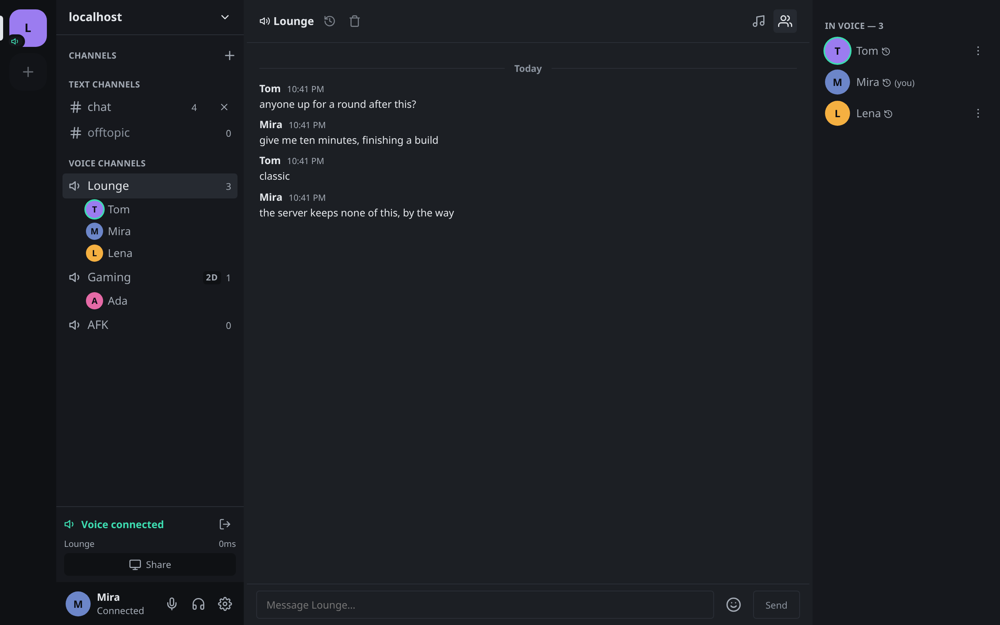
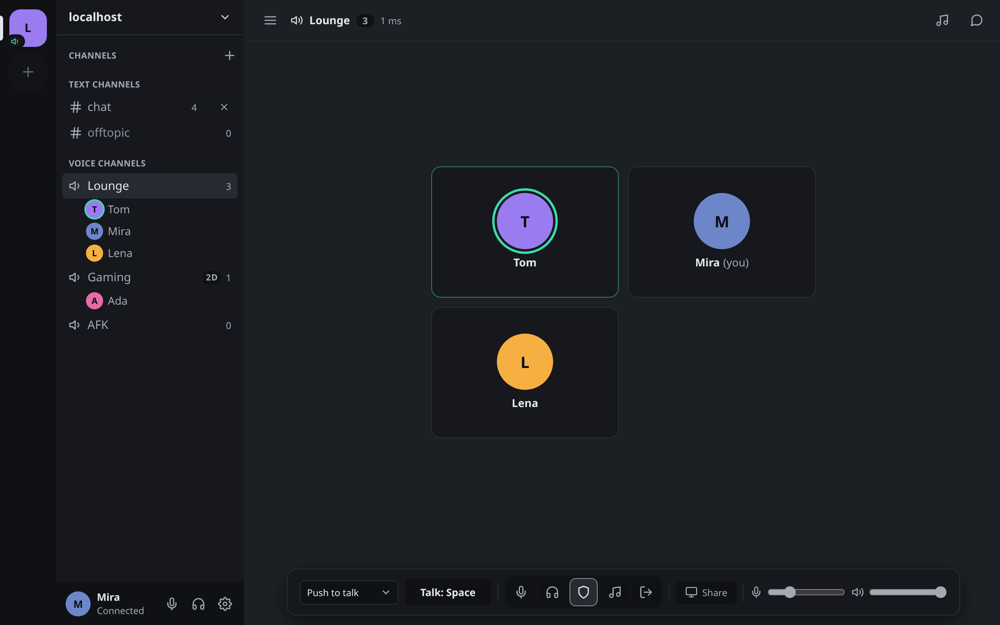
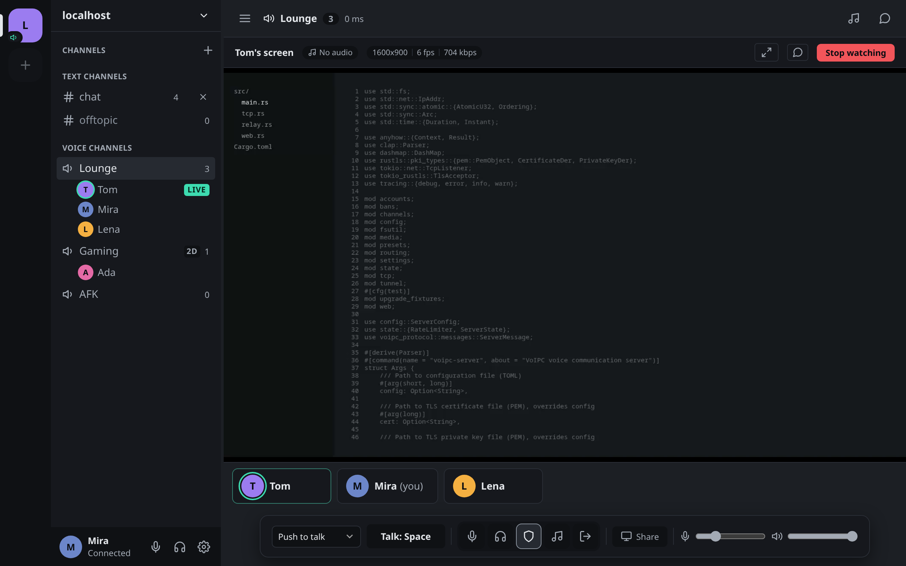
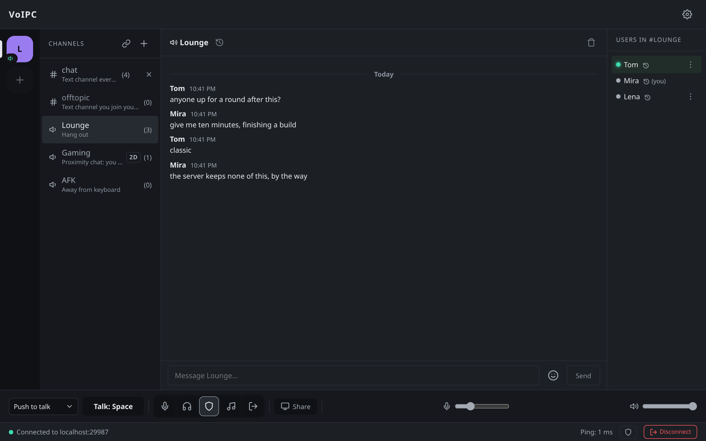
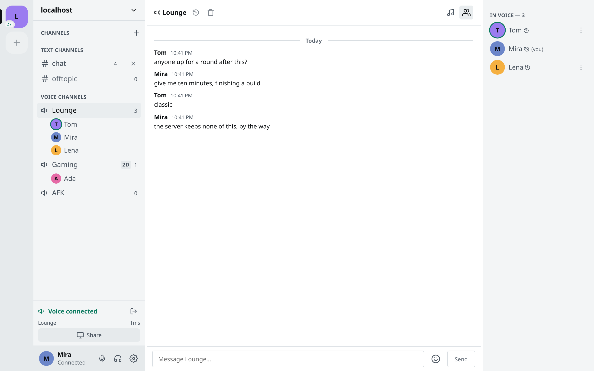
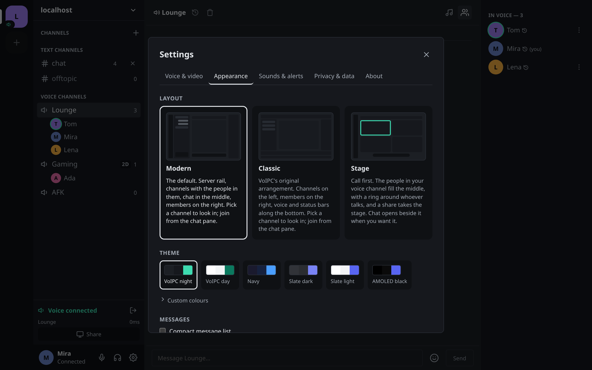
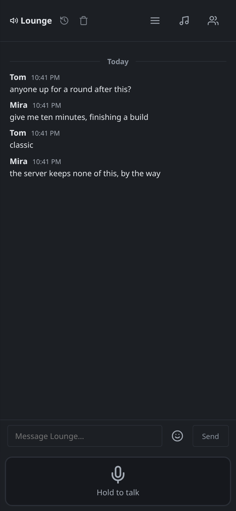
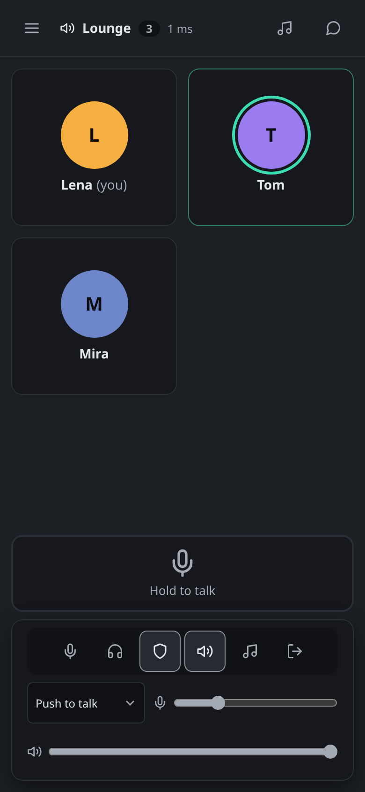

<p align="center">
  <br>
  <strong style="font-size: 2em;">VoIPC</strong>
  <br>
  <em>Privacy-first voice, video, and chat.</em>
  <br><br>
  <a href="#features">Features</a> &nbsp;&bull;&nbsp;
  <a href="#security">Security</a> &nbsp;&bull;&nbsp;
  <a href="#technology">Technology</a> &nbsp;&bull;&nbsp;
  <a href="#quick-start">Quick Start</a> &nbsp;&bull;&nbsp;
  <a href="#building">Building</a> &nbsp;&bull;&nbsp;
  <a href="#data-transparency">Data Transparency</a>
  <br><br>
  <a href="LICENSE"></a>
  
  
  
  
</p>

---

**VoIPC** is an encrypted, self-hosted voice/video/chat application. Think Discord or TeamSpeak, but with end-to-end encryption, zero data collection, and a server that keeps nothing it can read: only, for a day by default, the encrypted copies of files posted in chat, unless its operator also turns on accounts.

No accounts required. No telemetry. No compromises.

> **Updating from 1.0? Update the server first, then the apps.** 1.3.1 speaks protocol 13 and
> 1.0 speaks 12, and an app connects only to a server that speaks its protocol. The 1.0 desktop
> app offers 1.3.1 on every server: on a server that still runs 1.0, wait, since an updated app
> does not go back by itself. The browser needs nothing; Android and the `.deb` install over the
> old version. Running a server: [docs/OPERATING.md §8](docs/OPERATING.md#8-upgrading). Going
> back: [docs/COMPATIBILITY.md §4](docs/COMPATIBILITY.md#4-persisted-data).

<p align="center">
  
</p>

<p align="center"><em>The Modern layout, which is what a new install starts in. Classic and Stage are one click away in Settings.</em></p>

<table>
  <tr>
    <td><br><sub>Stage: the call in the middle</sub></td>
    <td><br><sub>Watching a screen share</sub></td>
    <td><br><sub>Classic, the original arrangement</sub></td>
  </tr>
  <tr>
    <td><br><sub>VoIPC day, for a light system</sub></td>
    <td><br><sub>Appearance: layout, palette, every colour</sub></td>
    <td> <br><sub>On a phone: Modern and Stage</sub></td>
  </tr>
</table>

<p align="center">
  <em>Every screenshot here comes from <code>node tools/screenshots.mjs --website</code>, against a scratch relay, so they are regenerated rather than retouched.</em>
</p>

## Features

**Voice Chat**
- Opus codec at 48 kHz / 20ms frames / 48 kbps
- ML-based noise suppression (RNNoise via nnnoiseless)
- Voice Activity Detection with configurable threshold
- Push-to-Talk, VAD, and Always-On modes
- Global Push-to-Talk and mute/deafen hotkeys (work when window is unfocused)
- Opus in-band FEC — a lost packet is rebuilt from the one that follows it
- Adaptive jitter buffer (40 → 160 ms, grows only under packet loss)
- Per-user volume control, 0–400% mic input gain, mic test in settings
- Audio device hot-recovery when a device dies mid-call

**Mixer**
- A mixing desk in the centre column, with a tab of its own on a phone: one channel strip per
  person, yours pinned at the front, each with a level meter, a real vertical fader and a mute
- **A lane is a lane.** Your microphone on the way out and each voice on the way in carry the same
  four controls: an **effect**, plus **muffle**, **reverb** and **water** at 0–10 each
- Thirteen effect chains — five radio grades, five phone grades, megaphone, gramophone and robot —
  from one parametric chain with drive, hiss, crackle, bit-crush, ring modulation and a squelch
- What you put on your own microphone is encoded into your voice, so everyone hears it and no
  listener can switch it off. What you put on somebody else's changes only what you hear, and a
  game driving the channel takes those over while it runs

**Screen Sharing**
- H.264 encoding via FFmpeg by default — every viewer can watch, browsers included.
  H.265/HEVC is one setting away when everyone watching is on a desktop client
- Hardware acceleration: NVIDIA NVENC, Intel QSV, AMD AMF (libx264/libx265 software fallback) — shipped in Windows builds since 0.4.0
- **Share from a browser too**: Chromium encodes H.264, Firefox VP9 (it cannot encode H.264), and every viewer decodes both
- 480p / 720p / 1080p @ 30 or 60 fps (60 fps gets +50% bitrate)
- Desktop audio capture (64 kbps Opus)
- Pop-out viewer window and fullscreen viewing; chat stays visible while watching
- VPN-safe packet sizes (1280 bytes — fits inside WireGuard and OpenVPN tunnels)

**Interface**
- **Three layouts, switchable at any time.** **Modern**: server rail, channel sidebar showing who is
  in every channel, chat in the middle, members on the right. **Classic**, the original: channels
  left, members right, voice and status bars along the bottom. **Stage**: the call in the middle,
  a tile for each person with a ring around whoever talks, and the chat in a drawer.
  In Modern and Classic, a click on a channel previews it and the button under the chat joins it
  (a double click on the row still works, where there is a mouse to do it with).
  Modern is the default, inspired by the chat apps most people arrive here from; you are asked
  which you want on the first connection, a layout you picked is kept, and the others are one
  click away in Settings → Appearance
- Seeing who is in a channel you are not in respects the same rules as everything else: a channel
  that hides its members or has a password shows nobody, an anonymous one shows its pseudonyms, and
  the server decides — the client is told, it does not work it out
- On a phone the modern layout is the phone shape you already know: channels swipe in from the left,
  members from the right, with buttons for both
- **Six palettes** — VoIPC night and VoIPC day (the defaults), Navy, Slate dark, Slate light and
  AMOLED black — and every colour in them can be changed individually. Until you pick one, the
  app follows your system's light or dark setting with VoIPC day or night; once you pick one it
  is yours and the system stops deciding. Compact messages, chat text size and an interface zoom
- Drag the modern layout's sidebars to any width, double-click a divider to put it back, and fold
  the member list away; each layout remembers its own widths

**Text Chat**
- Channel and direct messages, both end-to-end encrypted
- Replies that jump to what they answer, and threads (opened by hand, or gathered when a message draws a conversation)
- Markdown, with highlighted code blocks; HTML in a message is shown as text, never run
- @mentions, a "New" line at the first unread message, and search across every conversation on the device (never sent to the relay)
- Files and pictures, sealed on your device under a key of their own; pictures are made smaller (and lose their location data) unless you send the original, and nothing downloads until you press Load. The relay keeps the ciphertext for a day at most by default, and members who still have a file send it again when the relay has let it go
- Settings → Files: every file in your chats, which of them this device keeps, and the space they take
- Edit and delete your own messages, react with emoji, pin messages in a channel you manage, forward a message or a file to another conversation
- Encrypted local chat history (password-protected, AES-256-GCM)
- Encrypted poke notifications (like TeamSpeak pokes)
- Configurable chat history storage location
- Max 500 messages per channel stored locally

**Channels**
- Password-protected channels with invite system
- Per-channel media encryption keys
- Auto-cleanup of empty channels
- Configurable user limits
- Persistent rooms via `channels.json` on the server
- Invite links (`https://server:9987/#channel=name`): open the web client, or paste into the desktop connect dialog, and land in the channel — the password can ride in the fragment, which never reaches the server
- Newcomers get the last 50 channel messages from a member, end-to-end encrypted to them (opt-out in Settings → Data)

**Proximity Chat**
- A channel can be **2D** (a floor plan) or **3D** (height counts too), set when it is created and
  changeable afterwards by its creator, an admin or a moderator; operators can switch the whole feature off
- Voices are placed left/right and get quieter with distance, using the constant-power pan law and
  the inverse distance model every other implementation converged on. Desktop and browser render it;
  Android gets the distance but not the panning yet
- **Check your own setup**: Settings → Spatial Audio → *Test 2D* / *Test 3D* circles a synthetic
  voice around you through the real mixer, with a live readout of where it is
- A **virtual room** shows everyone on a top-down plan. Arrange people yourself — that layout stays
  on your machine — or turn on *Sync my position*, after which you move only yourself and your
  position is broadcast to the channel, encrypted like voice. Presets: round table, class room, line
- **Game SDK**: a game mod can drive the positions instead, over a local WebSocket. It is the open
  alternative to the TeamSpeak plugins RP servers use (SaltyChat, YACA, TokoVOIP) — no plugin, no
  license server, players addressed by their VoIPC user id. Ranges, per-player volume, distance
  culling, 0–10 muffling and thirteen radio/phone effect chains, with speaking and mute state
  pushed back to the game. A ready-made FiveM resource is in [sdk/fivem-voipc/](sdk/fivem-voipc/);
  the protocol is in [docs/SDK.md](docs/SDK.md), and which games it reaches — and which it
  cannot — in [docs/GAMES.md](docs/GAMES.md)
- **One speaker, heard several ways at once.** Every other proximity plugin makes a mod choose:
  somebody is *either* on your radio *or* standing next to you. A player here carries up to three
  extra **layers**, each with its own placement, chain, **ear** and **delay** — so a colleague two
  metres away who keys their radio is heard twice, and the earpiece of somebody's phone leaks at
  *their* head rather than yours
- **MumbleLink**, for games that will not talk to a mod at all: Guild Wars 2 and a few others
  write your own position into shared memory, and VoIPC can read it — the position and nothing
  else in the block, not your account name and not which server you are on
- **What a game may do to you, you decide.** It places people and that is all, until you say
  otherwise: broadcasting your position to the channel and pressing your push-to-talk are each a
  switch in Settings, both off by default. A game silencing somebody by leaving them out is shown
  — they go grey in the member list — and switching the integration off hands everything back

**Quality of Life**
- Saved servers in the connect dialog, optional auto-connect
- System tray (close-to-tray keeps the call running) and desktop notifications
- Voice quality indicator: live ping + packet-loss % in the status bar
- One QUIC connection per client — connection migration survives NAT rebinds, Wi-Fi roams and address changes
- Auto-reconnect keeps trying for 5 minutes (laptop sleep, server restart)
- UDP blocked on the way? With the server's TCP fallback on, the session moves to TCP by itself (the status bar says **· TCP**); without it, the connect fails with an error that says so instead of a silent mute
- Screen share adapts bitrate and frame rate to what the link carries (viewers report loss, the sharer steps down)
- Server admin session (without accounts): log in with the server's admin token (status bar shield) to kick users from any channel or from the server and to ban them for 1 h, 24 h or for good; bans outlast a restart and are listed with an Unban button. With accounts, admin and moderator are roles of accounts ([docs/ACCOUNTS.md](docs/ACCOUNTS.md))

**Platform Support**

| | Linux | Windows | Android | Browser | macOS |
|---|:---:|:---:|:---:|:---:|:---:|
| Voice | Yes | Yes | Yes (Oboe) | Yes (WebCodecs) | Untested¹ |
| Text chat (E2E) | Yes | Yes | Yes | Yes (Signal in wasm) | — |
| Screen Capture | PipeWire + XDG Portal | Windows.Graphics.Capture | — | getDisplayMedia | — |
| Desktop Audio | PipeWire | WASAPI | — | Where the browser offers a track² | — |
| Screen Share Viewing | Yes | Yes | Yes (AMediaCodec) | Yes³ | — |

¹ There is no macOS-specific code yet; nothing is built or tested for it.
² Chromium offers tab and system audio in its share picker; Firefox on Linux offers none, and
the audio indicator shows "no signal".
³ Every client decodes H.264, VP8 and VP9, so any browser can watch any share encoded in them —
which is why H.264 is the default. H.265 is the exception: browsers decode it only where the
platform provides it (Chrome/Edge on Windows and macOS, Safari 17+, Chrome on Android; Firefox
nowhere, and no browser on Linux). A viewer that cannot decode a share's codec is told so instead
of showing a black frame.

**Web client (browser)**

The server hosts the web client itself: open its address on port 9987 in a browser (the public
demo: <https://ivy.l4f.cc:9987>) and you get the same
UI as the desktop app, with the Signal Protocol and AES-256-GCM media crypto compiled to
WebAssembly. Needs Chrome 97+, Edge 98+, Firefox 130+, or Safari 26.4+ (WebTransport + WebCodecs);
Chromium and Firefox are both covered by the end-to-end test, including sharing a screen and
watching one. Sharing from a browser uses the browser's own picker; VoIPC picks the codec by
trying to encode with it, so Chromium shares H.264 and Firefox VP9 (its WebCodecs H.264 encoder
is broken, [Bugzilla 1918769](https://bugzilla.mozilla.org/show_bug.cgi?id=1918769)).

## Security

VoIPC encrypts everything at multiple layers. The server acts as a blind relay — it forwards encrypted packets without ever being able to read them. [docs/THREAT-MODEL.md](docs/THREAT-MODEL.md) lists what a relay, a channel member, someone with your disk and a hostile page can and cannot do, and which code and tests hold each part.

### Layer 1: Transport — TLS on every connection

All control traffic is encrypted with TLS 1.3 via **rustls** (pure-Rust, no OpenSSL). For self-signed server certs, the client pins the certificate fingerprint per `host:port` on first connect via **TOFU** (`TofuCertVerifier`) and aborts the handshake if it ever changes. If a server legitimately replaced its certificate, the connect dialog offers *Forget pinned certificate*; the next connect pins the new one. The first connection to a self-signed server is trusted blindly: the app shows the fingerprint it pinned, to compare with what `voipc-server cert fingerprint` prints on the server. Plaintext connections are never accepted.

### Layer 2: End-to-End Messages — Signal Protocol

Chat messages (channel and DM) use the **Signal Protocol** from the official [libsignal](https://github.com/signalapp/libsignal) crate by Signal Foundation:

- **PQXDH** (X25519 + ML-KEM-1024) for session establishment, so a session recorded today stays closed to a quantum computer later
- **Double Ratchet** together with **SPQR**, Signal's post-quantum ratchet — new key for every message
- **Curve25519** identity keys; pre-keys are signed with XEdDSA
- **100 one-time pre-keys** per connection plus a signed ML-KEM last-resort key; the server asks for 50 more when it is down to 10, and a replayed session start on the last-resort key is refused
- **Sender Keys** for efficient group/channel message encryption
- **Perfect Forward Secrecy** — a compromised key cannot decrypt past messages. Copies kept on a server with accounts are the exception: they have no forward secrecy (see *Data Transparency*). For channel chat the matching guarantee runs the other way and is what key rotation is for: a chain key stolen today would read *future* messages, so leaving a channel starts a new chain
- **Ephemeral identities by design** — for a guest, a fresh identity key pair is generated for every connection and never written to disk. A guest has no account and nothing to fingerprint or link across sessions. The trade-off is explicit: pre-key bundles come from the server, so protection against an *actively malicious* server substituting keys during session setup is not a goal for guests; protection against a passive or compromised-at-rest server is.
- **Lasting identities for accounts** (opt-in per server, see [docs/ACCOUNTS.md](docs/ACCOUNTS.md)) — an account keeps one identity key in its encrypted vault, and the people it talks to pin it the first time they see it. A changed key, a known name under another account, or a known account shown as a guest is announced instead of accepted silently. The server can still meet you first, and it can hand a device an old copy of the pins, or none: the app warns when it notices, which it does on a device that has seen them before. *Verify identity* in a member's menu shows a safety number the two of you can compare in person: if it matches, nobody stands between you, not even the server.

### Layer 3: Media — AES-256-GCM on every packet

All voice, video, and screen share audio is encrypted with **AES-256-GCM** (via the `ring` crate):

- Per-channel 256-bit symmetric key, randomly generated
- Deterministic nonce: `stream_id(4) || sequence(4) || type+fragment(4)` — prevents reuse by construction; domain-separated per stream type (voice / screen audio / video). `stream_id` is four random bytes the **sender** picks for itself on joining, carried in the packet header. Two members of a channel encrypt under the same key, so it is what keeps them off each other's nonces — and it is chosen by the client rather than the server, because a server that handed two speakers the same identifier would otherwise get the XOR of their voices
- 16-byte authentication tag on every packet — detects tampering
- AAD (Additional Authenticated Data) binds channel_id + packet_type + the sender's session id — blocks cross-channel replay, and a relay rewriting the header cannot make one member's voice play as another's
- A sender stops after 2³²−1000 packets on one connection (years of speech) rather than reuse a nonce
- Media keys are generated by the first member of a channel and handed to each joiner over the pairwise Signal session; the server relays the encrypted blob and never holds a media key
- **Rotated when somebody leaves**, so the key does not outlive the membership it was given for: the lowest remaining user id mints the next generation and hands it to the others, with no coordination and nobody elected by the server. The generation before stays usable for a moment, so packets already in flight are not an audible gap — which is also the window in which a member who just left can still read what was sent under the old key. Generations are a counter that wraps rather than a number that runs out, so no member can send the last one on the way out and freeze the channel on the key they are walking away with
- **Taken only from a member of the channel it names**, and only for the room the client is standing in. A media key is the key the microphone encrypts under, so a key offered by somebody the roster does not put in the channel is refused before it is even opened
- Plaintext media packet types are never sent and are dropped by both server and clients

### Layer 4: Local Storage — AES-256-GCM + PBKDF2

Client-side data at rest:

- The desktop keeps chat history, remembered devices and how far it read the server's copies in one file encrypted with your history password: **PBKDF2-HMAC-SHA256** (600,000 iterations) + **AES-256-GCM**
- 32-byte random salt + 12-byte random nonce per file; the data folder is readable by your user only, and the settings, the certificate pins and the history file are written 0600 (on Linux and Android)
- The browser keeps remembered devices sealed under a key it cannot export (IndexedDB), and read positions in plain localStorage
- Signal session state is never stored. A guest's identity is not stored either (see *Ephemeral identities* above); an account's identity key lives in its encrypted vault on the server, and a remembered device keeps the key to that vault
- Most key material is wiped from memory when it is dropped (`Zeroizing<T>`); not every copy is (a channel's media key, values that pass through the browser's JavaScript)

### Layer 5: Zero-Knowledge Server

- Server **never** sees plaintext messages (encrypted client-side)
- Server **never** stores readable chat history — without accounts nothing at all, with accounts only the encrypted copies members choose (see *Data Transparency*)
- Server **never** decodes voice/video (SFU architecture — relays encrypted packets)
- Server **never** logs conversations (without accounts: memory-only state, restart = clean slate, except the bans an admin made). At its default log level it writes no addresses or names; `debug` does

### What the comparison looks like

| | VoIPC | Discord | TeamSpeak |
|---|---|---|---|
| E2E Text Chat | Signal Protocol | No | No |
| E2E Voice & Video | AES-256-GCM | Partial (DAVE — voice/DM calls) | No |
| Self-Hosted | Yes | No | Yes |
| Open Source | MIT | No | No |
| Account Required | No | Yes | No |
| Data Collection | None (with accounts: sign-in records, hashed IPs) | Extensive | Some |
| Server Persistence | None by default; opt-in accounts database (messages only end-to-end encrypted) | Everything | Everything |
| Screen Share Codec | H.264 or H.265, HW-accel | H.264/VP8 | Limited |

## Technology

### Architecture

```
┌──────────────┐      QUIC · TLS 1.3        ┌──────────────┐      QUIC · TLS 1.3        ┌──────────────┐
│   Client A   │◄──────────────────────────►│    Server    │◄──────────────────────────►│   Client B   │
│  Tauri 2 App │  control stream + media    │  Rust Binary │  control stream + media    │  Tauri 2 App │
│  Rust+Svelte │  datagrams, AES-256-GCM    │  Tokio SFU   │  datagrams, AES-256-GCM    │  Rust+Svelte │
└──────────────┘                             └──────┬───────┘                            └──────────────┘
                                              Relays only —  │  HTTPS page (HTTP/2) +
                                              never decodes  │  the same QUIC endpoint
                                                      ┌──────┴───────┐
                                                      │  Web Client  │
                                                      │ Svelte+wasm  │
                                                      └──────────────┘
```

- **One QUIC (WebTransport) connection** per client, TLS 1.3 only: control messages (auth,
  channels, chat, encryption key exchange) on a bidirectional stream, voice and screen-share
  audio as datagrams, each video frame on its own unidirectional stream. NAT rebinds and
  address changes are handled by QUIC connection migration
- **TCP fallback** (opt-in, `tcp_fallback`): where UDP does not get through, clients carry
  the same session through a WebSocket on the server's TLS port — control, voice and video,
  voice first — and the server relays it exactly as it relays QUIC
- **SFU** (Selective Forwarding Unit) — server relays encrypted packets without decoding
- **HTTP/2 page** for browsers: the same origin serves the web client, which then opens the
  same QUIC endpoint the desktop app uses. Browsers get no plaintext the native clients
  don't — all encryption happens in the page, in WebAssembly

### Stack

| Layer | Technology | Details |
|---|---|---|
| **Audio** | Opus via audiopus | 48 kHz, mono, 20ms frames, 48 kbps, FEC, DTX |
| **Noise Suppression** | nnnoiseless (RNNoise) | ML-based, 480-sample frames at 48 kHz |
| **Video Codec** | H.264 (default) or H.265 via FFmpeg 8 | NVENC → QSV → AMF → libx264/libx265 fallback; browsers also send VP9/VP8 |
| **Encryption** | libsignal-protocol + ring | Signal Protocol for messages, AES-256-GCM for media |
| **TLS** | rustls 0.23 + ring | Pure-Rust TLS 1.3, TOFU cert pinning |
| **Serialization** | postcard | Binary, no_std compatible, minimal overhead |
| **Server Runtime** | Tokio | Async, single-binary, DashMap lock-free concurrency |
| **Client Backend** | Tauri 2 (Rust) | Native IPC, audio/video/crypto all in Rust |
| **Client Frontend** | Svelte 5 + TypeScript | Runes ($state, $derived, $effect), Vite 6 |
| **Web Client** | WebAssembly + WebCodecs | Same Svelte UI; Signal + media crypto in wasm, Opus and video via WebCodecs, WebTransport for control and media |
| **Audio I/O** | cpal / Oboe | ALSA (Linux), WASAPI (Windows), Oboe (Android) |
| **Screen Capture** | Platform-native | PipeWire ScreenCast (Linux), Windows.Graphics.Capture (Windows) |

### Protocol Details

| Metric | Value |
|---|---|
| Voice packet header | 9 bytes (15 encrypted) |
| Video packet header | 15 bytes (21 encrypted) |
| Max voice packet | 512 bytes |
| Max video packet | 1,280 bytes |
| Max control message | 64 KiB |
| Protocol version | v13 (client and relay must match; [docs/COMPATIBILITY.md](docs/COMPATIBILITY.md)) |
| Default port | 9987 — UDP for QUIC (all clients), TCP for the browser page, file transfers and the TCP fallback |

### Project Structure

```
VoIPC/
├── crates/
│   ├── voipc-protocol/     # Message types, packet formats, codec
│   ├── voipc-server/       # Server binary (QUIC/WebTransport endpoint, HTTPS page, TCP fallback)
│   ├── voipc-audio/        # Capture, playback, Opus, RNNoise, VAD, jitter buffer
│   ├── voipc-video/        # H.264/H.265 encoding, H.264/H.265/VP8/VP9 decoding, fragment assembly
│   ├── voipc-crypto/       # Signal Protocol, AES-256-GCM, key management
│   └── voipc-web/          # wasm build of protocol + crypto for the browser client
├── client/
│   ├── src-tauri/src/      # Tauri Rust backend (network, crypto, state, commands)
│   │   ├── screenshare/    # Platform-specific capture (linux.rs, windows.rs)
│   │   ├── transport.rs    # QUIC connection or TCP fallback, certificate pinning (TOFU)
│   │   ├── network.rs      # Control/media tasks, Signal session setup
│   │   ├── crypto.rs       # Chat history encryption (PBKDF2 + AES-256-GCM)
│   │   ├── app_state.rs    # Central app state (connections, audio, crypto)
│   │   └── commands.rs     # Tauri IPC command handlers
│   └── src/
│       ├── lib/
│       │   ├── components/ # Svelte 5 components
│       │   └── stores/     # Reactive state (channels, chat, voice, etc.)
│       ├── web/            # Browser backend: WebTransport, Signal orchestration,
│       │                   #   WebCodecs audio/video, Tauri API shims
│       └── App.svelte      # Root component
├── website/                # Project website (single HTML file)
├── tools/                  # Build task runner — npm run <task>, one per build
├── setup.sh / setup.ps1    # One-command dependency installer (Rust, Node, system libs)
├── test-web.sh             # Headless two-browser end-to-end test of the web client
└── Cargo.toml              # Workspace root
```

## Quick Start

### Server

```bash
# Build
cargo build -p voipc-server --release

# Generate self-signed TLS certificate for this machine's name and address
# (browsers check them: set HOST and IP to the public ones if they differ)
HOST=$(hostname -f) IP=$(ip route get 1 | grep -o 'src [0-9.]*' | cut -d' ' -f2)
mkdir -p certs
openssl req -x509 -newkey ec \
  -pkeyopt ec_paramgen_curve:prime256v1 \
  -keyout certs/server.key -out certs/server.crt \
  -days 365 -nodes -subj "/CN=voipc" \
  -addext "subjectAltName=DNS:$HOST,IP:$IP"

# Run
./target/release/voipc-server
```

The server listens on port **9987** by default: UDP for the QUIC endpoint every client
connects to, TCP for the browser page. Configure it with a TOML file, which it reads only when
started with `-c` (`voipc-server -c server.toml`; the `admin` and `db` commands need the same
`-c server.toml`, before the command):

```toml
host = "::"               # Bind address — "::" serves IPv6 and IPv4 from one listener; "0.0.0.0" for IPv4 only
tcp_port = 9987           # HTTPS: the browser page, file transfers (and the TCP fallback)
udp_port = 9987           # QUIC endpoint (all clients) — keep equal to tcp_port so one host:port reaches both
tcp_fallback = false      # true: clients that cannot reach UDP carry everything over tcp_port (see below)
max_users = 64
max_connections_per_ip = 32   # A browser client holds two of these, a native client one — so 32 is sixteen browser users behind one NAT
cert_path = "certs/server.crt"
key_path = "certs/server.key"
admin_token = "change-me"  # optional; unset = a random token is printed in the log at every start (with accounts, only while no account is admin)

[files]                    # the encrypted file cache, on by default (docs/OPERATING.md §11 has every key)
max_size_mb = 10           # largest file blob
max_age_hours = 24         # no blob stays longer; all of them go at every start
```

> **IPv6:** `host = "::"` is the default and serves both families from one listener (a host with IPv6 disabled falls back to `0.0.0.0` automatically). Do not pin `host` to a concrete IPv4 address while your domain publishes an AAAA record: the browser client then fails while everything else looks healthy, because the page and `/wt.json` are TCP and Chrome quietly falls back to IPv4 after the refused IPv6 attempt, while the WebTransport session is UDP and has no such fallback — it dies with `ERR_QUIC_PROTOCOL_ERROR`.

> **UDP blocked?** Some hosts drop UDP in front of the server (a provider firewall, an
> anti-DDoS filter): the page loads, but every client times out connecting over QUIC.
> `sudo tools/udp-diag.sh` finds where the packets die. Where UDP cannot be opened, set
> `tcp_fallback = true` (or pass `--tcp-fallback`): a client that does not get through over
> QUIC within two seconds then carries the whole session — control, voice, video — through
> a WebSocket on `tcp_port`, the port the page already uses. TCP waits for every lost packet,
> so on a lossy network voice lags more than over QUIC; the status bar says **· TCP** while
> it is in use. Desktop and Android clients dial the fallback on the port they were given,
> so keep `tcp_port` equal to `udp_port`.

> **VPN / multi-homed setups:** If clients connect via a domain name that resolves to a specific IP, set `host` to that IP. Otherwise the server may send QUIC packets from the wrong interface and the handshake never completes. Some options can also be passed as CLI flags (`--host`, `--tcp-port`, `--udp-port`, etc.; `voipc-server --help` lists them).

Runtime settings in `server_settings.json`:

```json
{
  "empty_channel_timeout_secs": 300,
  "max_channels": 50,
  "max_channel_name_len": 32,
  "proximity_enabled": true,
  "game_token": null
}
```

`proximity_enabled: false` switches proximity chat off for the whole server: every channel is served as non-positional, requests to enable it are refused, and position beacons are not relayed.

`game_token` (unset by default) is a bearer token a **game server** may present to `POST /game/v1/routes`, which narrows who hears whom inside a channel whose `routed` flag is on. Unset, that endpoint answers 404 and this server has no idea games exist. It is not the admin token and is deliberately much weaker: no session list, no names, no kick, no bans — only "these players may hear each other, for the next few seconds", as opaque ids it forgets.

**Persistent channels** (optional): drop a `channels.json` in the directory the server runs from (or pass `--channels <path>`) to pre-create long-lived rooms that survive restarts. See [channels.example.json](channels.example.json) — plaintext `password` fields are hashed to SHA-256 on first load and the file is rewritten atomically. Per channel:

| Option | Default | Effect |
|---|---|---|
| `proximity` | `"off"` | `"2d"` or `"3d"` makes it a proximity room |
| `hidden` | `false` | Not listed in the sidebar for non-admins. It can still be joined — by an invite link, by the game SDK, or by anyone who knows it is there — so it is out of the way, not locked. Give a channel a `password` if you need it shut, and both if it is the one your game drives |
| `anonymous` | `false` | Members see each other as `Guest-1234`, a fresh name per visit. The server substitutes it everywhere, so no client ever learns the real one; admins see the real names, and no chat history is handed over in such a channel. Voice channels only, and it hides a name rather than a person: user ids are the same everywhere, so somebody who is also in a channel where you can see them can be matched up by id — which is why a text channel, one you are in *besides* the voice channel you stand in, may not be anonymous at all |
| `screen_share` | `true` | `false` refuses screen sharing there |
| `hide_members` | `false` | Non-admins see no member list, only whoever is speaking (and can still adjust their volume). Nobody outside is told who joins or leaves either — only that the count changed — which is the same rule a password channel follows |
| `routed` | `false` | The server forwards each voice only to whoever should hear it, instead of to every member. For a channel a game drives, where "every member" can be a whole map. **The one option that tells this server anything about who hears whom** — members in such a channel say which of the others they want to hear, and a game server with `game_token` may narrow that further. Positions, names and audio stay as unreadable to it as ever. Everyone joining is told, and the channel is marked **R** |
| `text` | `false` | Makes it a **text channel**: no voice, no screen share, no proximity. Joining one is a subscription rather than a move, so any number can be open at once and none of them costs the voice channel you stand in |
| `message_ttl_secs` | `0` | A **message destruction timer**: seconds a message written here lives before every client deletes it, `0` for none. Up to 30 days. Without accounts the server stores no chat and deletes nothing — this is what the channel tells its members, and each client stamps it on what it sends, inside the encryption where the relay cannot reach it. With accounts, the server also deletes the copies members keep there when their timer runs out. It applies to what is written from then on, not to what people already have |
| `auto_join` | `false` | Only with `text`. Clients join this channel on connect. A user who leaves it is not brought back — the client remembers that, which is why the server joins nobody by itself. There is no limit on how many a client holds: the budgets that pay for joining them are sized from how many channels this server has |
| `announce` | `false` | Only with `text`. An **announcement channel**: only its managers — admins and moderators, and for a channel somebody created, its creator — may post, and the server refuses everybody else's messages. It reads none of them; who posts where is all it checks. A member's shared history from such a channel is still shown as second-hand, as everywhere |
| `slow_mode_secs` | `0` | **Slow mode**: each member may post once per this many seconds, up to 6 hours; `0` is off. The server holds them to it, the channel's managers are exempt, and the chat shows the countdown rather than letting a message be sent and refused |
| `nsfw` | `false` | Marks the channel **18+**. Each app asks its user, once per server, to confirm being 18 or older before joining or showing such a channel, and never joins one by itself (`auto_join` waits for that answer). The server only carries the flag. It is a question, not an age check: give the channel a `password` too if it has to stay shut |

The creator of a channel, or any admin or moderator, can change these at runtime through the channel's gear icon. Channels from `channels.json` have no creator, so only admins and moderators can change those.

**Channel presets.** Rather than writing `channels.json` by hand, start from one of the built-in layouts and edit from there:

```bash
./voipc-server channels presets                   # list them
./voipc-server channels init community            # write channels.json from one
./voipc-server channels init roleplay --dry-run   # look first; writes nothing
```

| Preset | For |
|---|---|
| `starter` | A small all-round server: one chat everybody lands in, a few rooms, AFK |
| `gaming` | A friend group or multi-game community: game rooms, a stream room, a proximity campfire, a looking-for-group board with slow mode |
| `roleplay` | A role-play game server: a hidden, locked, routed `Ingame` channel the game drives ([docs/SDK.md](docs/SDK.md)), out-of-character rooms, support and whitelist rooms, staff-only announcements |
| `mmo` | A guild or clan (WoW, FFXIV and co): guild hall, raid comms, party rooms capped at eight, raid sign-ups that expire with the weekly lockout, officers' rooms |
| `competitive` | Shooters and MOBAs: duo, trio, squad and five-stack rooms capped at their size, an in-house lobby with two team rooms, VOD review |
| `tabletop` | Pen & paper: a proximity table the game master shares a map at, a whisper corner, a tavern, lore and character channels |
| `study` | A study group or co-working: a silent room, a proximity library, small group rooms, one-to-one tutoring |
| `lan` | A LAN party or tournament: info and brackets only the orga posts in, match rooms per team, a locked casters' room, a help desk |
| `project` | A team, Slack-style: announcements, team channels, written stand-ups, meeting rooms, a proximity virtual office |
| `family` | Family and friends: a chat everyone lands in, a living room, movie and game nights, a locked corner for the grown-ups |
| `community` | Creators and communities: moderator-only announcements, slow mode, feedback and bug reports, a stage, playtests, and a locked 18+ area |

No preset ships a password: one in a preset would be the same on every server that used it. Every locked channel is given a fresh random one instead, printed once when `init` runs; the file keeps only its hash. Where a layout needs server settings — `roleplay` a `game_token`, `family` and `community` a lower `max_channels` — `init` writes `server_settings.json` if there is none, and otherwise leaves yours alone and prints what to put in it. An existing `channels.json` is only replaced with `--force`, which keeps the old one as `channels.json.bak` (`.bak.2` and so on after that). `--out` writes it elsewhere; `--channels` and `--settings` choose other paths too, but go before the command: `voipc-server --settings path/server_settings.json channels init roleplay`. What comes out is an ordinary `channels.json`: restart the server to load it. A preset copied by hand still says `"<generate>"` where a secret belongs, and the server refuses to start on it rather than lock a channel with a password everybody can read.

**Text channels.** A voice channel is still one at a time: joining another moves you. A text channel is not — you subscribe to as many as you like, read them while sitting in a voice room, and leave one from the ✕ on its row. Clicking a text channel you are not in reads it rather than joining it; entering is a button in the chat pane, so a stray click never puts you back in a channel you left. Anyone can create one at runtime too (the + button, then *Text*), and like any user-created channel it disappears once the last member leaves and the empty-channel timeout passes. Messages are end-to-end encrypted the same way voice-channel chat is, one sender-key group per channel, and each message is bound to its channel inside the ciphertext — a relay cannot show it as belonging to another one. When somebody leaves a channel, the next message sent there starts a fresh key chain, so a former member stops reading the live chat. On a server with accounts, an account that kept copies of the channel stays a reader of what is kept there after leaving, until it is kicked from that channel or the channel gets a new password.

**Messages can be given a destruction timer.** Off everywhere by default. A channel's creator, an admin or a moderator sets one from the channel's gear icon — five minutes to seven days — and from then on every message written there is deleted by every client once its time is up, including from the copies members have handed to people who joined later. A direct message has no channel to take that from, so there the clock icon in the chat header is your own: it travels with the messages you send, and the other side deletes them when it runs out.

The timer rides inside the encryption, next to the message, so the relay can neither read nor change that copy of it. A copy kept on a server with accounts also tells the server its timer, so the server can delete it on time; the app still goes by the one inside. A deadline is worked out once, when a message arrives, from the message's own timestamp — which is why every copy of it goes at the same moment rather than a few minutes apart. What a member re-sharing a conversation claims about a message is only ever the outer bound: the channel's own timer applies to what they hand over too, including to a message they strip it from, and a copy of something you already hold can bring its deletion forward but never push it back. What that does not do is make a member trustworthy: somebody who was there can always keep their own copy of what they read, whatever the timer says. It is a rule about the app, not about people.

**Chat history is opt-in, shared between members, and yours to delete.** Without accounts the server stores no messages, so a channel's past reaches a newcomer only because members offer it. With accounts it can also come from the copies members keep on the server ([docs/ACCOUNTS.md](docs/ACCOUNTS.md)).

Because it reaches them that way, it is that member's word: a guest's identity is ephemeral and never stored, so nothing signs what a member hands over and there is nothing to check it against. Between accounts, the copies kept on the server are signed by their writers ([docs/ACCOUNTS.md](docs/ACCOUNTS.md)), but history handed over by a member is still only that member's word. Messages that arrive as history are therefore shown as second-hand, and stay second-hand when they are passed on — a member who invents a conversation and attributes it to somebody else can be believed, but never mistaken for the person they are quoting.

- **Who shares** is visible: a member who answers requests is marked in the member list. It is one flag per person, like mute, and, on a server without accounts, the only thing about chat the server is told — it has always seen the requests go past. Turn it off under Settings → Data
- **Several people are asked, and the answers are merged.** Whoever was away holds the older half of a conversation, whoever just arrived holds only the newest. A newcomer asks up to three members who share, and what comes back is folded into one history in order. Each message carries an id minted by its sender inside the encryption, so two copies of the same message are recognised as one; a divider shows which part came from whom
- **Deleting is permanent.** Clearing a channel records what was there, and nothing older is merged back in — so what you deleted stays deleted, however often a member re-offers it. The history button in the chat header asks the sharers again and takes that back, for when you cleared it by accident
- **History is kept per server**, and on desktop in an encrypted file you unlock with a password (Settings → Data, or turn it off and keep chat in memory only). Two servers' `#general` are two conversations, which also means a server cannot ask for what its users wrote somewhere else
- **Conversations are filed by server and by the name of the person**, so a DM you had yesterday is not shown as one with whoever happens to hold that user id today. Which also means a name is what a conversation follows: on a server where somebody else takes a name after its owner leaves, the two look like one person to your archive — a guest's name is only kept unique while the person holding it is online. On a server with accounts, an account's name stays its own, and a guest cannot take it
- **What the server can still do:** it decides who is in a channel, so it can place somebody there and the members will hand them a key. End-to-end encryption means the server cannot read what is said — not that it cannot add a listener. It has to do it in the open, though: a client accepts a sender key, accepts a media key, answers a request for history and shows a message only from somebody the roster says is in the channel with it, so an added listener is one the member list shows (kept copies on a server with accounts are the exception: their readers need not be in the member list, and your app names each new one in the channel instead). That holds against a server that seats somebody, not against one that swaps the keys it relays: a guest's identity is made fresh for every connection and nobody verifies it, so a server that hands out its own keys in place of a guest's can still read along unseen. Between accounts the gap narrows to the first meeting: identities are pinned, a later change is announced, and comparing safety numbers shows a key that is not the person's

**Accounts (optional):** set `[accounts] mode = "optional"` (or `"required"`) in `server.toml` and the server keeps accounts in SQLite or Postgres: a name that is reserved, two-factor codes for admins and moderators on new devices, and — for members who choose it — encrypted copies of their messages, so what was written while they were away is there when they come back. Guests still work unless you say otherwise. Setup, the command line (`voipc-server admin invite`, `admin grant`, `admin revoke`, `admin reset-2fa`, `db backup`) and what the server learns are in [docs/ACCOUNTS.md](docs/ACCOUNTS.md).

**Server administration:** without accounts, any connected user becomes admin for their session by entering the admin token (status bar → shield icon). With accounts, roles belong to accounts: admin and moderator. Moderators can kick, ban and change any channel's settings, but cannot kick or ban an admin or another moderator (though they can kick one out of a channel they created themselves), and only admins see the ban list. The admin token makes the first admin, once, then is refused on that server. Set `admin_token` in `server.toml`, pass `--admin-token`, or export `VOIPC_ADMIN_TOKEN`; without one the server prints a fresh random token in its log at every start (with accounts, only while no account is admin). Admins can kick users from channels or from the server and ban them for 1 h, 24 h or for good. A ban covers the address (an IPv4 address, or the IPv6 /64), so everyone behind it is kept out too, except accounts that hold a role there; with accounts, it can cover the account as well, from any address, and an admin can ban an account by name from the ban list. Bans outlast a restart: with accounts they are kept in the database as a keyed hash of the address, never the address; without accounts in `bans.json` (readable by the server's user only) next to `channels.json`. From the server's shell: `voipc-server ban list`, `ban add --account NAME` or `--ip ADDR` (with `--reason` and `--days`), `ban remove ID`; a running server picks changes up within five minutes. Other users see a shield next to an admin's name. Three wrong tokens disconnect the session.

### Client

```bash
# Linux
./setup.sh       # Install system dependencies, Rust and Node
npm run build    # Release build

# Windows (PowerShell as Administrator)
.\setup.ps1
npm run build
```

Every build task runs through `npm run <task>` on both platforms;
`node tools/voipc.mjs --help` lists them.

Or manually:

```bash
cd client
npm install
npx tauri dev     # Dev build + run
npx tauri build   # Release build
```

`npm run release` builds the web bundle and the server that embeds it into `release/`. The
portable release files (the static server, the AppImage, the .deb, the Windows installer and the
APK) come from the release workflow on GitHub, with `SHA256SUMS` and build attestations
([SECURITY.md](SECURITY.md#verifying-a-download)).

See [BUILDING.md](BUILDING.md) for detailed platform-specific instructions and dependency lists.

### Web client

Nothing to install: point a browser at the server's address on port 9987, as with the public
demo, <https://ivy.l4f.cc:9987>.

The server binary serves the web client over HTTP/2 and carries voice, video and control
messages over WebTransport on the same UDP port the desktop app uses (**9987**) — no extra
port to open. Where UDP is blocked and the server has its TCP fallback on, the page carries
the session through a WebSocket on its own TCP port instead. With a self-signed certificate the browser shows a warning on the first visit;
accept it once and the app works (generate the certificate with a `subjectAltName`, see the
openssl line above, or use a real certificate from a CA). Browsers pin the QUIC endpoint by
certificate hash, so for them the server presents a short-lived certificate it generates,
rotates, and publishes by hash to the page — there is nothing to configure. Desktop clients
get the operator certificate on the same endpoint and pin it on first use as before.

Requires Chrome 97+, Edge 98+, Firefox 130+, or Safari 26.4+ for voice, chat and watching a
share (H.265 shares are the exception — see the platform table). Sharing your own screen
additionally needs `VideoEncoder` and `getDisplayMedia`, which rules out most mobile browsers;
it is tested on Chromium 152 and Firefox 155, and the Share button hides itself where the
browser cannot do it. In Firefox the output-device picker does nothing — routing audio to a chosen device is a
Chromium extension the other engines have not implemented.

To build it yourself:

```bash
npm run web        # wasm + Vite bundle, then a server binary that embeds it
VOIPC_SELFTEST=1 npm run web   # the same with the in-page self-test, which test:web needs
npm run test:web   # headless two-browser end-to-end check (voice, chat, DMs, screen share,
                   # proximity, and a run through the real UI in the Chromium lanes)
npm --prefix client test   # browser-side unit tests (spatial maths, room presets)
```

## Data Transparency

### What the server stores (in memory only)

- Active usernames and channel memberships
- Channel names, descriptions, passwords (`Zeroizing<String>` — cleared on drop)
- Connection metadata (IP addresses while connected)
- Pre-key bundles for Signal session establishment

The server never holds a media key: it relays the encrypted blobs members hand each other.

**Without accounts, nothing is written to disk but `bans.json`, once an admin bans someone, and the file cache: a server restart is otherwise a clean slate.** The file cache holds the files posted in chat as their senders' apps encrypted them, each under a key only the end-to-end message carries, for a day by default (`max_age_hours`), and is wiped at every start. Accounts are something a server's operator turns on; what such a server keeps is listed below.

### What the server never sees

- Message contents — encrypted with Signal Protocol before leaving your device
- Voice/video content — encrypted with AES-256-GCM before transmission
- Chat history — stored on your device, encrypted; on a server with accounts also as end-to-end-encrypted
  copies for members who choose them, which the server cannot read
- Your private keys — only public keys are exchanged; an account's private keys reach the server only
  sealed in its encrypted vault
- Where you stand in a proximity room — positions are encrypted with the channel key like voice; the
  relay sees only that a member is sharing one. Positions a game feeds in stay on your machine
  unless you switch on *Let a game broadcast my position* — and then only your own goes out, still
  encrypted, still unreadable to the relay, though every member of the channel can read it
- Which radio channel anyone is on, or that radio channels exist. Radio entitlement is a job check
  in the game server's own resource; the relay forwards encrypted audio to a VoIPC channel and
  knows nothing else. The cost is worth stating: an honest client renders only what it should, and
  a patched one can hear the whole channel — exactly as with SaltyChat, YACA and TokoVOIP

### What the server sees in a routed channel

A channel can be marked **routed** (off by default; see the channel options above). There, and
only there, the relay is told one extra thing so it can forward each voice to the people who
should hear it instead of to everybody:

- **What it learns:** for each member, the set of other members they currently want to hear, as
  user ids, changing a few times a second. If the game server is connected to it, that server's
  own answer for who *may* hear whom, as opaque ids salted per run — which it resolves on receipt
  and then forgets
- **What it still never learns:** any position, range or distance; any radio channel, call or job
  name; any name it did not already have; and any audio it can read. The routing endpoint refuses
  a request carrying a field it does not recognise, so a coordinate cannot reach it by accident,
  and there is no way to read anything back out of it
- **It is not cryptographic separation.** The channel shares one media key, so this stops packets
  reaching a client, not a client from reading the packets it gets. Radio entitlement is still a
  job check in the game server's own resource
- Everyone joining such a channel is told this, in a notice they have to dismiss, and the channel
  carries an **R** in the list

### What a server with accounts keeps (opt-in)

Off unless the operator sets `[accounts] mode`. Then the server keeps a database — and every member is told what is in it:

- **For every account:** its name; an Argon2id hash of a secret the app derives from your password (the password itself never leaves your device); your identity's public key; the public key of each device you sign in on with your password, which lets that device sign in without the password (*Forget* under *Your account* ends that; the server deletes a key unused for 90 days); your two-factor secret, sealed with a key file kept outside the database; your roles; and sign-in records with hashed IP addresses (the server's log holds plain addresses only at its `debug` level). Bans: a keyed hash of a banned address, never the address, and banned accounts
- **Your vault,** encrypted on your device. It opens with your password, on a device the server remembers, or with your recovery key (*Forgot your password?* when you sign in). It holds your identity key, other people's pinned identities, your choices and your log key. The server keeps it and cannot open it without guessing your password: each guess costs 600,000 PBKDF2-SHA256 rounds, so a long password you use nowhere else is what protects it
- **Only if you say yes to copies on the server** (asked once, changed under *Your account*): your messages, encrypted end to end. The server learns who wrote in which channel or direct conversation, when, how long each message is, each message's destruction timer (for a direct message, the one you chose), and which channels you keep — never the text and never a key. Copies go when their timer runs out, or after the server's retention (a year unless the operator chooses otherwise)
- **People who join a channel later** can read what you wrote there before unless you say no: it is the switch *Share recent channel chat with newcomers*, which is on by default and ticked in the copies question. With it on, someone who joins gets the keys to everything you kept in that channel, not only recent chat. Either way, every account your app hands a key to is named in the channel as it happens, on the device that hands it over, so nobody is added without you seeing it
- **Kept messages are signed** by you, so the people they are for can prove you wrote them, and a kept copy has no forward secrecy: whoever later gets into a member's account can read what that member could. The server can withhold or replay copies; it cannot forge or alter them. You can delete yours, and your account, from the server (*Your account*); copies people's devices already have may stay
- **The browser client is served by the server itself,** so a server that turns hostile can change the page. It can read what you type there, and it can use what the browser keeps for the account (the remembered device key and the key to your vault) to sign in as you and read everything kept for you. The same goes for every other server you open in that page: it handles them all. The desktop app does not have that problem; use it where you do not run the server yourself
- **A server that turns hostile still cannot read kept messages** (except through a browser it serves, above), but it holds your vault and decides who is listed as a member: it can drop or roll back what it keeps (your pinned identities too: your app warns when it notices), guess your password offline at the cost above, and meet you before the person you meant to meet. Your app names every new reader, warns when a known name turns up as another account, and safety numbers show who is in between ([docs/ACCOUNTS.md](docs/ACCOUNTS.md))
- **Use a password you use on no other server:** a server can pretend to be another one. The app and the browser refuse a server that claims an id they know from another address

### What your device stores

- Encrypted chat history (`VOIP` binary format, password-protected)
- Audio/video settings and device preferences
- Max 500 messages per channel, auto-rotated
- Files you sent or loaded, still sealed under their keys: up to 1 GB by default on the desktop and 256 MB on Android (Settings → Files), in memory only in the browser
- With an account: a remembered device's key and, with it, the key to your vault (desktop: inside the encrypted
  chat history, or only in memory while that is off; browser: IndexedDB, under a key the page cannot export),
  how far it has read the server's copies, and whom it has named as readers
- Which account id each server address gave at its last sign-in (desktop: `relay_ids` in `settings.json`; browser: `voipc.relay_ids` in localStorage)

### What is never stored anywhere

- No analytics or telemetry
- No user accounts or profiles, unless the server's operator turns accounts on
- No server-side message logs — only the end-to-end-encrypted copies of members who choose them
- No tracking of any kind
- No third-party data sharing

## Contributing

VoIPC is MIT licensed. Contributions are welcome.

1. Fork the repository
2. Create a feature branch
3. Make your changes
4. Run the checks CI runs:
   - `cargo fmt --all` and `cargo clippy --workspace --all-targets -- -D warnings`;
   - `cargo test --workspace --locked` and `npm --prefix client test`;
   - `./test-web.sh` after `VOIPC_SELFTEST=1 npm run web`, for anything the browser client
     touches.

   [BUILDING.md](BUILDING.md#toolchain-all-platforms) lists the full gate.
5. Submit a pull request

Security issues go to [SECURITY.md](SECURITY.md), not to a public issue. Running a relay:
[docs/OPERATING.md](docs/OPERATING.md).

## License

VoIPC's own source code is [MIT](LICENSE).

The binaries are built with third-party code under other licences, and whoever passes them on
does so under those terms as well:

- **[libsignal](https://github.com/signalapp/libsignal)**, the end-to-end encryption, is
  **AGPL-3.0-only**. It is linked into the desktop and Android clients, the server and the
  browser client's WebAssembly.
- **FFmpeg** is **GPL** in the builds VoIPC bundles: the Windows installer ships BtbN's
  `gpl-shared` build, and the AppImage carries FFmpeg with x264 and x265. The `.deb` uses the
  system's FFmpeg. Each release's notes name the exact FFmpeg build and link its source.

Every build carries `THIRD-PARTY-NOTICES.txt` beside its page: each Rust crate and npm package
in it, the licence VoIPC uses it under, and the copyright and licence texts those licences ask
a binary to carry. A relay serves it at `/THIRD-PARTY-NOTICES.txt` on its port (the demo's:
<https://ivy.l4f.cc:9987/THIRD-PARTY-NOTICES.txt>).
`node tools/voipc.mjs notices` writes it into `client/public/`, and every build does so before
Vite copies it into the bundle.

---

<p align="center">
  <em>Built with Rust, Svelte, and paranoia.</em>
  <br>
  <sub>No cookies. No tracking. Not even on this README.</sub>
</p>
